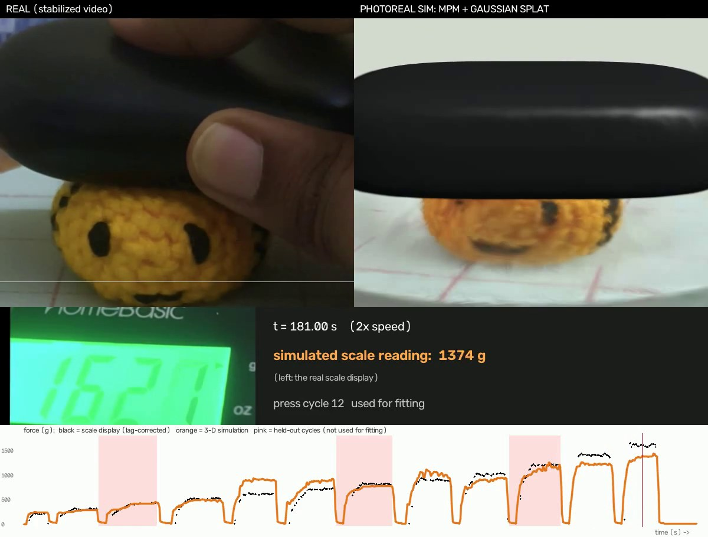
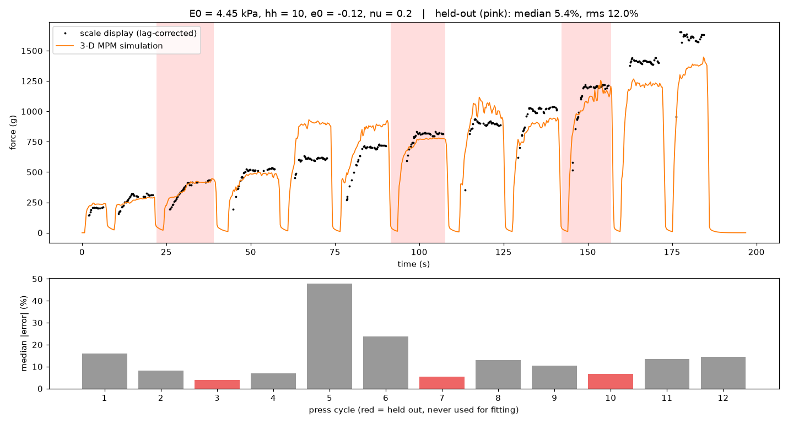

# Pressing a crocheted bee: a 3-D deformation model fitted from video

A 10 g crocheted bee (45 × 47 × 70 mm, fibre-stuffed) is pressed with a hand-held stone while it sits on a kitchen scale.
From one handheld phone video, the pipeline measures, frame by frame, **how far the bee is compressed** and **what the scale
reads**. It then fits a **3-D material-point (MPM) simulation** of the bee to that data. The fitted model **predicts
press cycles it never saw** (held out), and the result is rendered **photorealistically** through a Gaussian splat of the
real toy.



| Deliverable | File |
|---|---|
| Demo: real vs **photoreal** sim (MPM + Gaussian splat), side by side | [`media/demo_photoreal_vs_real.mp4`](media/demo_photoreal_vs_real.mp4) |
| Demo: real vs **particle** sim, side by side | [`media/demo_particles_vs_real.mp4`](media/demo_particles_vs_real.mp4) |
| Input video (the clip everything is fitted to, stabilized onto the table, 30 fps, no audio) | [`media/input_stepped_presses_stabilized.mp4`](media/input_stepped_presses_stabilized.mp4) |
| Orbit of the reconstructed bee (Gaussian splat) | [`media/splat_orbit.mp4`](media/splat_orbit.mp4) |
| Fit result figure | [`media/fit3d_dense.png`](media/fit3d_dense.png) |

Both demos play at 2× speed. Each shows the real stabilized footage next to the simulation from the same viewpoint and
scale, with the real scale display and the **simulated** scale reading under them. A force trace runs along the bottom,
and the held-out cycles are marked (pink, "HELD OUT - prediction").

---

## Results

**Fitted material** (3-D MPM, fixed-corotated hyperelastic with compaction hardening, ν = 0.2):

| | value |
|---|---|
| Young's modulus at rest, E0 | **4.45 kPa** |
| hardening `hh`: E_eff = E0 · (1 + hh · c_max), with c_max the deepest volumetric compaction a point has seen | **10** |
| contact offset `e0` (strain at first stone contact, relative to the video-measured crown) | **-0.12** |
| display lag (scale shows a value ~0.21 s after the load) | 0.21 s |

**Prediction accuracy** is the scale reading error on the **held-out press cycles 3, 7 and 10**. Those cycles were
simulated (the history matters) but never used in the loss.

| model | params | held-out median abs. error | held-out rms | train median |
|---|---|---|---|---|
| 1-D linear spring | K, e0, lag | 14.1 % | 16.7 % | 18.6 % |
| 1-D history-stiffening spring (`D`) | + h | 8.3 % | 12.3 % | 15.3 % |
| 1-D `D` + Maxwell branch (viscoelastic) | + K1, τ | 8.3 % | 12.3 % | 15.1 % |
| **3-D MPM, gravity, friction, wings (this repo's main model)** | E0, hh, e0 | **5.4 %** | **12.0 %** | 13.8 % |



Per cycle (median abs. error): held-out cycles 3 / 7 / 10 come out at 4.0 % / 5.5 % / 6.8 %. Most training cycles are
between 7 % and 16 %, and cycles 5 and 6 are outliers at 48 % and 24 % (see Limitations).

What the data does and doesn't pin down:
- **Stiffness and its growth with compaction are identified.** The linear spring is clearly worse, so the bee stiffens
  as its stuffing is compacted, and it remembers the deepest press. The tradeoff is a ridge: E0, hh and e0 trade off
  almost perfectly. The 12-point grid's training χ² ranges only from 22.1 to 25 across E0 = 4.5 to 18 kPa. **Read the
  numbers as one point on a ridge**, not as independently measured constants. The best point sits on the grid edge
  (e0 = -0.12), but the neighbouring e0 = -0.08 is equal within 0.05 %.
- **Damping/viscosity is not identifiable from this data.** Adding a Maxwell (stress-relaxation) branch to the 1-D model
  does not improve held-out prediction at all (8.3 % → 8.3 %). The scale updates at ~4 Hz, and any relaxation is below
  what the display resolves. The bee also shows no visible rebound ringing. The damping in the 3-D sim is therefore
  numerical: set so motion is quiet and ring-free like the real toy, and not fitted.
- **Deformation shape.** The bee's eyes and mouth were tracked as material markers in the real video
  (`src/track_face.py`). The same material points in the sim (`src/face_sim.py`) favour ν ≈ 0.2 over ν = 0 for how the
  compression is distributed between the upper and lower body.

---

## Approach

```
handheld video ──► stabilize (homography to the table) ──► per-frame bee height ──► strain
             └──► scale-display crop ──► 7-segment reader ──► force (g)
strain + force ──► 1-D models (what physics is needed?) ──► 3-D MPM fit (E0, hh, e0) ──► held-out check
orbit videos ──► COLMAP + 3D Gaussian Splatting ──► splat aligned to sim (mm) ──► PhysGaussian-style render of the fitted sim
```

1. **Capture** (`CAPTURE.md`). The bee was weighed (10 g) and measured (45 × 47 × 70 mm). It was orbited on video before
   any pressing (for the splat). Then it was pressed 12 times with a smooth hand-held stone, in stepped holds of rising
   depth (up to ~1.6 kg). It sat on a tared kitchen scale whose display is in the same frame. The phone was hand-held,
   1080p and 60 fps.
2. **Stabilization** (`src/stabilize.py`, `src/stabilize_all.py`). SIFT features on the static parts only (scale body,
   platform, table: image rows 760 to 1700) are matched to a reference frame (t = 75 s), and a RANSAC homography warps
   every frame into that view. This removes hand shake, so pixel distances in the bee's region become physical
   distances.
3. **Strain** (`src/strain_stab.py`). Within a fixed region around the bee, a yellow colour mask gives the top edge
   (= the stone's contact line while pressed) and the bottom edge. Strain = 1 − (bottom − top) / 320 px, where 320 px is
   the 47 mm rest height (6.8 px/mm). Spikes and the occluded release frames are cleaned and interpolated (13.5 % of
   frames).
4. **Force** (`src/lcd_read.py`, `src/build_series.py`). The display crop is registered to the LCD rectangle. Each of
   the 7 segments in each digit cell is sampled for darkness, with per-segment gains calibrated on the clip itself. A
   value is accepted only when it is stable across at least 4 frames. Checked against manual reads: 45 of 57 matched
   exactly, and several mismatches were the reader correcting the manual reads.
   The result is 453 display values, of which 294 are training targets and 116 held-out targets. The display lags the
   load by 0.21 s; this lag is fitted.
5. **1-D model selection** (`src/fit_dense.py`). Strain (60 fps) drives each model and every display value is a target.
   Leaving whole cycles out shows that **history-dependent stiffening** is needed and **viscoelasticity is not**
   (table above).
6. **3-D MPM** (`src/mpm_bee.py`, Taichi on the GPU, MLS-MPM):
   - **Geometry.** The bee is an ellipsoid body with two wing lobes attached in body coordinates, about 62,800 particles
     on a 2 mm grid.
   - **Material.** Fixed-corotated hyperelastic, with stiffness growing with the deepest compaction each particle has
     seen (the 3-D version of the 1-D `D` model).
   - **Gravity and the scale.** Gravity is on and the mass is 10 g. The bee first settles under its own weight. The
     scale was tared with the bee on it, so the simulated reading is the floor reaction minus the weight.
   - **Contacts.** Floor and stone are Coulomb friction contacts (μ = 0.3) with free separation, so nothing sticks.
   - **Pusher.** The stone is a rigid plane driven by the measured strain. The strain is low-passed at 2 Hz, sampled every
     0.25 s, and the pusher speed is capped. Contact on/off also comes from the video (the stone's edge), because the
     display drops to 0 up to ~1 s before the stone actually leaves.
   - **Time compression.** The press is quasi-static, so real time is compressed 50×. Grid damping is scaled with it
     (damping × compression held constant), so the bee's elastic ring stays fast and critically damped and is not
     visible.
7. **Fit** (`src/fit_mpm_dense.py`). A 3 × 4 grid over (hh, e0) is run three at a time on the GPU. E0 is solved in
   closed form at each grid point (force ∝ E at a fixed shape). The best point is then **re-simulated at that E0**, so
   the reported errors come from a real run.
8. **Photoreal rendering** (`colab/`, run on a Colab L4 GPU through the Colab CLI):
   - **Splat.** The orbit clips are sampled at 4 fps and the blurriest 15 % of frames are dropped. COLMAP registered all
     223 of 223 images, and nerfstudio splatfacto trained for 20k iterations, giving 182k Gaussians.
   - **Alignment** (`src/splat_align.py`). The splat is aligned into the simulation's mm frame using the floor plane
     (RANSAC), the measured height, the long axis (PCA) and the face direction (dark Gaussians). Reconstructed extents
     are 52.9 × 46.4 × 67.3 mm, against 45 × 47 × 70 mm measured (the width includes the wings).
   - **Deformation** (`colab/stageB_physgauss.py`, after PhysGaussian). Each bee Gaussian is bound to its 8 nearest MPM
     particles. Each frame, its centre moves with their weighted displacement and its covariance is deformed by the
     local deformation gradient: Σ' = F Σ Fᵀ. The stone is rendered as a solid shaded rounded slab, and everything is
     rasterized with gsplat from the real panel's viewpoint.

## Assumptions

- **Contact geometry.** The stone is a flat rigid plane covering the whole top of the bee. In reality it is a hand-held
  rounded stone that can tilt.
- **Material.** The bee is one homogeneous, isotropic material, with stiffness growing with local compaction. The
  crochet shell and the fibre stuffing are not modelled separately, and the wings are made of the same material.
- **Poisson's ratio.** ν = 0.2 is fixed, not fitted. It was chosen from the eye-marker deformation check.
- **Rate independence.** The material is treated as rate-independent, which the 1-D viscoelastic test supports. That
  is what makes time compression valid.
- **Friction.** μ = 0.3 is assumed for both stone and floor. It is not measured.
- **Camera.** The camera elevation is not calibrated. Estimates from bee proportions and the bottom-edge drop range
  from 5° to 28°, and 15° is used for the rendered sim view. Strain is measured in the image plane of the stabilized
  view.
- **Scale.** The scale is assumed ideal apart from the fitted 0.21 s display lag.

## Limitations

- **Cycle-to-cycle drift.** Training cycles 5 and 6 are over-predicted by 48 % and 24 %. The real bee was softer there
  than either its earlier or later behaviour implies. That is consistent with the stuffing re-arranging between
  presses, and with the hand-held stone pressing off-centre or tilted. Neither is in the model, and a single material
  history cannot fit both cycles.
- **Parameter ridge.** E0, hh and e0 are strongly correlated (see Results). The predictions are robust, but the
  individual values aren't.
- **Damping is not measured** (see Results). Rate-dependent behaviour at faster presses than these is untested.
- **Recovery after release.** The bee recovers slowly after release. The video measurement of its free height is too
  noisy (wings, ring and stray fibres in the colour mask) to fit a recovery time. The sim recovers elastically and is
  heavily damped.
  For about 1 s after each release, the simulated reading also shows a 20 to 60 g decaying tail. This is the grid damping
  acting on the recovering bee, a numerical artifact. It falls in zero-force periods, which are not fitting targets.
- **Release lag.** Contact on/off follows the 2 Hz-smoothed video edge, so the simulated release lags the real one by
  about 0.1 to 0.2 s.
- **Photoreal render.**
  - The splat captures the bee's appearance in its undeformed state only, so compressed crochet does not change shade
    the way real compressed fabric does.
  - Parts outside the MPM body (the metal ring, the wing tips) are hidden while they are under the stone.
  - The background comes from the orbit session, not the press session.
- **One object, one clip.** All fitting uses a single 197 s clip of one toy.

---

## Reproduce

Data: the input video in the repo, `media/input_stepped_presses_stabilized.mp4`, is the full clip after stabilization
(`src/export_stabilized.py`), compressed to 30 fps. The original handheld 60 fps recording (499 MB) is not included. It is
too large for git, and nothing downstream needs it: every per-frame measurement taken from it is committed
(`out/frames.csv`, `out/series.csv`, `out/lcd_gain.npy`), as is the aligned splat (`splat/bee_sim.npz`). So everything
from the 1-D fits onward runs without any video. The orbit clips (161 MB) are omitted for the same reason. The two
video-reading steps below expect the original at `presses/5 second long presses.mp4`.

```bash
pip install -r requirements.txt       # plus ffmpeg on PATH; an NVIDIA GPU for Taichi (CPU works, much slower)
```

```bash
python src/stabilize_all.py           # video -> out/frames.csv, cache/lcd.npy   (needs the original clip)
python src/build_series.py            # -> out/series.csv (per-frame force + strain)
python src/fit_dense.py               # 1-D models, leave-cycles-out
python src/fit_mpm_dense.py           # 3-D MPM fit (~1 h on an RTX 4060 laptop GPU) -> out/fit3d_dense_best.json
python src/plot_fit3d.py              # -> out/fit3d_dense.png
python src/render_compare.py          # particle side-by-side -> out/compare.mp4 (needs the original clip)
```

Photoreal stage (Google Colab, GPU), run from WSL with the [Colab CLI](https://pypi.org/project/google-colab-cli/):

```bash
bash colab/upload_orbit.sh            # then: colab exec -s beesplat -f colab/stageA_setup.py ; ... -f colab/stageA_run.py
python src/splat_align.py             # local: splat -> sim frame, -> splat/bee_sim.npz
bash colab/stageB_redo.sh             # L4 session, PhysGaussian render -> splat/photoreal_sim.mp4
python src/render_compare.py --photoreal splat/photoreal_sim.mp4    # -> out/compare_photoreal.mp4
```

## Repository layout

| path | contents |
|---|---|
| `src/` | **Main pipeline:** `stabilize*`, `export_stabilized`, `strain_stab`, `lcd_read`, `build_series`, `fit_dense`, `mpm_bee`, `fit_mpm_dense`, `plot_fit3d`, `render_compare`, `splat_align`. **Checks:** `track_face`, `face_sim`, `screen_shape`, `check_wings`, `render_sim`. **Earlier exploration** on the first short press clips, superseded by the above: `track_height`, `press_events`, `crops_big`, `fit_lumped`, `fit_nl`, `fit_steps`, `fit_mpm`, `report_mpm`. |
| `colab/` | GPU stages on Colab: splat training (`stageA_*`), PhysGaussian render (`stageB_*`), CLI helper scripts |
| `out/` | Per-frame data, fit results (`fit3d_dense_best.json`, grids, logs), check figures. `*_tc200`, `*_nu0`, `*_sticky`, `*_floatingwings`, `*_rawstrain` are archived earlier variants. |
| `splat/` | Aligned bee splat (`bee_sim.npz`), training cameras, renders. The full `splat.ply` (45 MB) is not committed. |
| `media/` | Deliverable videos and figures |

## Credits

- **MLS-MPM:** Y. Hu et al., *A Moving Least Squares Material Point Method*, SIGGRAPH 2018. Implemented here in
  [Taichi](https://github.com/taichi-dev/taichi).
- **Fixed-corotated elasticity:** A. Stomakhin et al., *Energetically Consistent Invertible Elasticity*, SCA 2012.
- **3D Gaussian Splatting:** B. Kerbl et al., SIGGRAPH 2023. Trained with
  [nerfstudio](https://github.com/nerfstudio-project/nerfstudio) `splatfacto` and rasterized with
  [gsplat](https://github.com/nerfstudio-project/gsplat).
- **PhysGaussian:** T. Xie et al., *PhysGaussian: Physics-Integrated 3D Gaussians for Generative Dynamics*, CVPR 2024.
  The idea of deforming splat covariances with the MPM deformation gradient comes from this paper. The binding of
  Gaussians to a coarser MPM proxy is this repo's own simplification.
- **Camera poses:** [COLMAP](https://colmap.github.io/) (J. Schönberger & J.-M. Frahm, CVPR 2016).
- **Libraries:** OpenCV (SIFT, homographies), SciPy, NumPy, Matplotlib, ffmpeg.
- **Compute:** Google Colab (L4 GPU) via the Colab CLI.
- Built with the help of an AI coding assistant (Claude Code).
